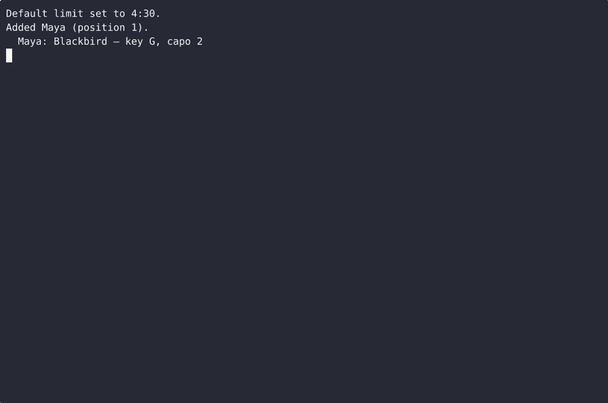
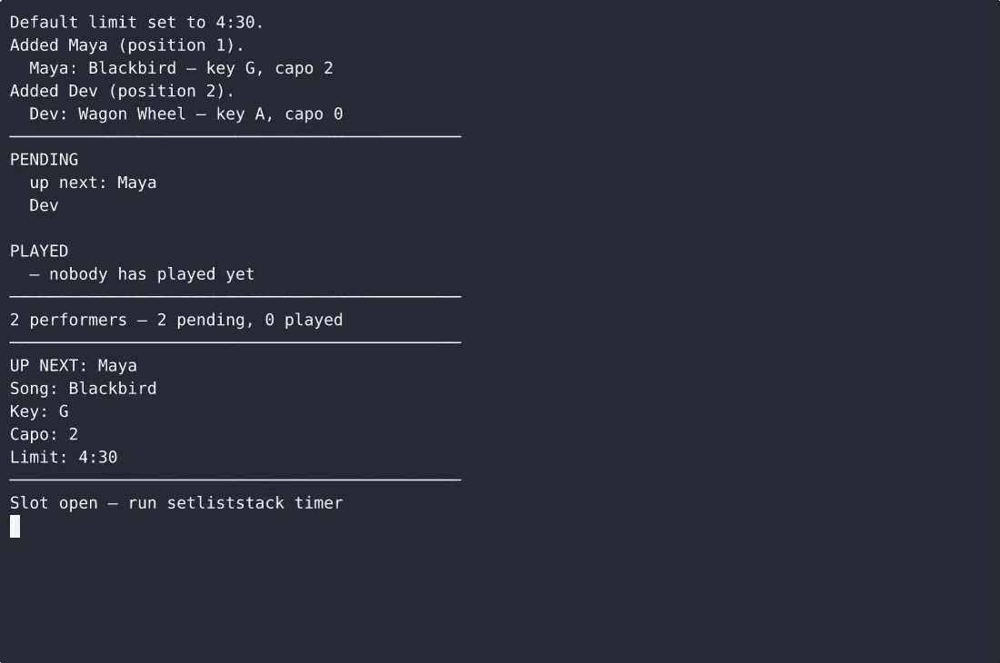

# SetlistStack — complete Full-stack app command-line tool example app

If you want a self-hosted command-line tool without the vendor lock-in, **SetlistStack** is ready to run. Built with Full-stack app and Apache-2.0-licensed, SetlistStack ships complete — one clone, one install command. SetlistStack is a single-file, standard-library-only Python command-line tool for running an open-mic night: it keeps a strict round-robin rotation so nobody repeats until everyone has played, stores each performer's…. [Open SetlistStack on cenius.ai](https://cenius.ai/marketplace/p/setliststack?ref=gh&utm_campaign=setliststack-webapp) to customise it without touching a line of SetlistStack code.


[](LICENSE)  [](https://cenius.ai)

[](https://cenius.ai/marketplace/p/setliststack?ref=gh&utm_campaign=setliststack-webapp)

> **▶ [Open & edit in cenius.ai](https://cenius.ai/marketplace/p/setliststack?ref=gh&utm_campaign=setliststack-webapp)** — one click to an editable workspace: describe changes in plain English, get an instant preview, one-click deploy and host. Modifications made on the platform come with full rebrand & relicense rights.

_Local clone? See [Quick start](#quick-start) below. cenius.ai is the zero-setup path._

## Demo


▶ **[See it in action](https://cenius.ai/marketplace/p/setliststack?ref=gh&utm_campaign=setliststack-webapp)** — full demo on the project page · [MP4](.github/media/demo.mp4)

## Screenshots

 

## Features

- Strict round-robin rotation
- Song key and capo tags
- Live per-slot countdown with chime and over-time indicator
- Persistent night state
- Night wrap-up: log and reset

## Quick start

```bash
./install.sh   # installs dependencies + seeds demo data
```

See [`INSTALL.md`](INSTALL.md) for full setup and usage instructions.

## Architecture

Folder layout not shown. Run `./install.sh` once to install packages and populate demo data — the app is ready to use immediately after. Built in Full-stack app (12 files). Step-by-step setup guide: [`INSTALL.md`](INSTALL.md).

## Usage guide

Every example below is a real, copy-pasteable command with the output it
produces. `python3 setliststack.py` is abbreviated as `setliststack` where the
lines get long; run whichever form you like.

### Set the night's slot length

```
$ setliststack limit
Default limit: 5:00 (built-in)

$ setliststack limit 4:30
Default limit set to 4:30.

$ setliststack limit
Default limit: 4:30 (set)
```

The default is stamped onto every slot that `next` opens. `timer --limit MM:SS`
overrides it for one set only and rewrites that slot's limit.

### Build the sign-up list

```
$ setliststack add "Maya" --song "Blackbird" --key G --capo 2
Added Maya (position 1).
  Maya: Blackbird — key G, capo 2

$ setliststack add "Dev"
Added Dev (position 2).
```

Names are trimmed, must be 1–40 characters, and are unique regardless of case:

```
$ setliststack add "  maya "
Maya is already in the rotation. Next: setliststack roster
```

### See the rotation

```
$ setliststack roster
──────────────────────────────────────────────
PENDING
  up next: Maya
  Dev

PLAYED
  — nobody has played yet
──────────────────────────────────────────────
2 performers — 2 pending, 0 played
```

Once everyone has played the pending section says so and names the command that
starts a new round.

### Tag a song's key and capo

```
$ setliststack song "Dev" --song "Wagon Wheel" --key A --capo 0
Dev: Wagon Wheel — key A, capo 0

$ setliststack song "Dev"
Dev: Wagon Wheel — key A, capo 0

_Full guide: [`USAGE.md`](USAGE.md)_

## FAQ

### How do I self-host SetlistStack?

Pull the repo, run `./install.sh`, and you are up — the script installs packages and pre-seeds the database. [`INSTALL.md`](INSTALL.md) covers any platform-specific tweaks.

### Can I use SetlistStack in a commercial project?

Yes — Apache-2.0-licensed, so commercial use, modification, and distribution are all permitted. Read the full terms in [LICENSE](LICENSE).

### How can I customize SetlistStack without editing code?

[cenius.ai](https://cenius.ai/marketplace/p/setliststack?ref=gh&utm_campaign=setliststack-webapp) handles the implementation. Tell it what you want in everyday words, pick up the updated build. No coding needed.

### What powers SetlistStack under the hood?

SetlistStack runs on Full-stack app. This repo holds the full production source: you can inspect every part of it before deploying. Highlights include persistent night state.

### How do I make SetlistStack my own brand?

Yes. The MIT license lets you remove the original branding and ship under your own name. For a guided approach, [remix it on cenius.ai](https://cenius.ai/marketplace/p/setliststack?ref=gh&utm_campaign=setliststack-webapp): you get a fresh build with full rebrand and relicense rights.

## License & rebranding

Released under the [Apache License 2.0](LICENSE) (© 2026 Cenius AI) — free for personal and commercial use. The Cenius name/logo are trademarks (see NOTICE).

**Need a customized version?** [Remix this app on cenius.ai](https://cenius.ai/marketplace/p/setliststack?ref=gh&utm_campaign=setliststack-webapp) — modifications made on the platform come with **full rebrand & relicense rights** over your derivative.

## Built with cenius.ai

This entire application — code, design, seeded demo data — was generated on **[cenius.ai](https://cenius.ai)** from a plain-English description.

- 🚀 [Build your own app on cenius.ai](https://cenius.ai)
- 🎛️ [Remix SetlistStack on the marketplace](https://cenius.ai/marketplace/p/setliststack?ref=gh&utm_campaign=setliststack-webapp) — open it in a workspace, prompt for changes, and ship your own version.

More open-source apps: [the Cenius-ai catalog](https://github.com/Cenius-ai) · [showcase index](https://github.com/Cenius-ai/showcase)
